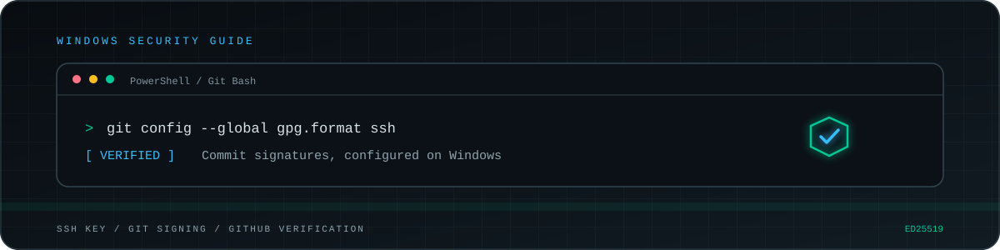
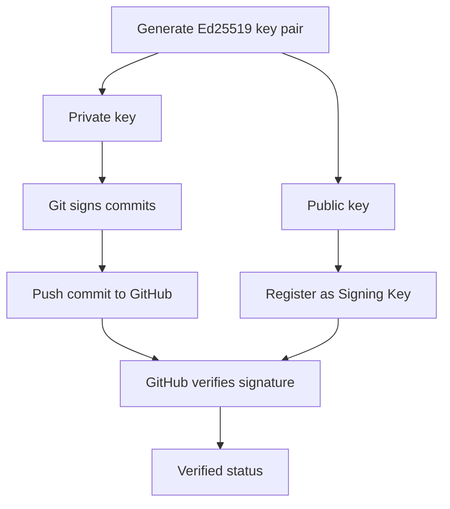
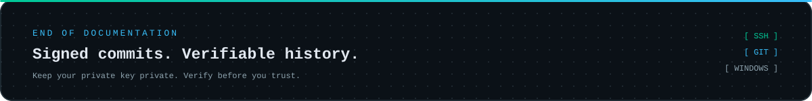

<div align="center">



<br>

[](https://www.microsoft.com/windows)
[](https://git-scm.com/)
[](https://www.openssh.com/)
[](https://docs.github.com/en/authentication/managing-commit-signature-verification/about-commit-signature-verification)
[](https://git-scm.com/docs/git-config#Documentation/git-config.txt-gpgformat)
[](LICENSE)

[](README.md)
[](README.md)
[](CONTRIBUTING.md)
[](https://github.com/RufusTheDwarf/git-signed-commits-windows/stargazers)
[](https://github.com/RufusTheDwarf/git-signed-commits-windows/forks)
[](https://github.com/RufusTheDwarf/git-signed-commits-windows/issues)
[](https://github.com/RufusTheDwarf/git-signed-commits-windows/commits/main)

<br>

**A practical guide to SSH commit signing on Windows.**

Generate a dedicated SSH key, configure Git and get your commits verified by GitHub.

[Quick Start](#-quick-start) · [Full Tutorial](#-full-tutorial) · [Security](#-security) · [Troubleshooting](#-troubleshooting)

</div>


## `01` // Overview

Git allows you to sign commits using SSH keys. GitHub can then verify those signatures and display a **Verified** indicator next to eligible commits.

This repository provides a step-by-step guide to configuring that workflow on **Windows 10 and Windows 11**.

The setup uses:

- Git for Windows for version control and commit signing.
- OpenSSH to generate an Ed25519 key pair.
- A dedicated SSH key for signing commits.
- GitHub to register the public signing key and verify signatures.
- An `allowed_signers` file for local signature verification.

No previous knowledge of SSH signing, GPG or cryptography is required.

### What you will achieve

| Capability | Result |
|:--|:--|
| Dedicated SSH key | Signing key separate from authentication |
| Automatic signing | Git signs new commits automatically |
| Local verification | Inspect signatures using Git |
| GitHub verification | Obtain the `Verified` status when requirements are met |
| Key protection | Understand private-key security and Windows permissions |


## `02` // How it works

A signed commit contains a cryptographic signature created with your private key. The corresponding public key allows the signature to be verified.

Your private key stays on your computer. Only the public key is registered on GitHub.



### Signing vs authentication

These two SSH operations have different purposes:

- **Authentication:** proves your identity when connecting to a remote server.
- **Signing:** creates a cryptographic signature attached to a Git commit.

This guide creates a separate signing key. Your existing SSH authentication keys remain untouched.

### What is `allowed_signers`?

Git uses the `allowed_signers` file to identify trusted principals when verifying SSH signatures locally.

It is not your private key, it is not uploaded to GitHub, and it does not register your key with your GitHub account.

GitHub uses the public signing key registered in your account to verify commits on its platform.


## `03` // Requirements

Before starting, make sure you have:

- Windows 10 or Windows 11.
- [Git for Windows](https://git-scm.com/download/win).
- Git 2.34 or later.
- Git Bash.
- OpenSSH tools, including `ssh-keygen`.
- A GitHub account.
- A commit email address associated with your GitHub account.

Check your Git version:

```bash
git --version
```

Check OpenSSH:

```bash
ssh-keygen -V
```

If the second command displays usage information or an option-related error, that does not necessarily mean OpenSSH is missing. Check that the command is available:

```bash
command -v ssh-keygen
```

Check your Git identity:

```bash
git config --global user.name
git config --global user.email
```

If necessary, configure it:

```bash
git config --global user.name "Your Name"
git config --global user.email "your-email@example.com"
```

Use an email address associated with your GitHub account. You can also use your GitHub-provided `noreply` address.

[GitHub documentation: Setting your commit email address](https://docs.github.com/en/account-and-profile/how-tos/email-preferences/setting-your-commit-email-address)


## `04` // Quick Start

This section provides the essential commands. For explanations and verification, continue to the full tutorial.

Open **Git Bash**.

**1. Prepare the SSH directory**

```bash
SSH_DIR="$(cygpath -u "$USERPROFILE")/.ssh"
mkdir -p "$SSH_DIR"
```

**2. Define your Git email and signing key**

```bash
GIT_EMAIL="$(git config --global --get user.email)"

KEY_NAME="id_ed25519_signing"
SIGNING_KEY="$SSH_DIR/$KEY_NAME"
```

**3. Generate the signing key**

```bash
ssh-keygen -t ed25519 -C "$GIT_EMAIL" -f "$SIGNING_KEY"
```

**4. Configure Git**

```bash
SIGNING_KEY_WIN="$(cygpath -m "$SIGNING_KEY")"

git config --global gpg.format ssh
git config --global user.signingkey "$SIGNING_KEY_WIN.pub"
git config --global commit.gpgsign true
```

**5. Configure local verification**

```bash
ALLOWED_SIGNERS="$SSH_DIR/allowed_signers_git"

printf '%s %s\n' "$GIT_EMAIL" "$(cat "$SIGNING_KEY.pub")" > "$ALLOWED_SIGNERS"

ALLOWED_SIGNERS_WIN="$(cygpath -m "$ALLOWED_SIGNERS")"

git config --global gpg.ssh.allowedSignersFile "$ALLOWED_SIGNERS_WIN"
```

**6. Register your public key on GitHub**

```bash
cat "$SIGNING_KEY.pub"
```

Copy the output and add it to [GitHub SSH keys](https://github.com/settings/keys) using the key type **Signing Key**.

**7. Verify your configuration**

```bash
git config --global --get gpg.format
git config --global --get user.signingkey
git config --global --get commit.gpgsign
```

The full tutorial below explains each operation and how to test it.


## `05` // Full Tutorial

### Step 1 - Prepare the SSH directory

Open Git Bash.

The following command uses your Windows user profile to locate the `.ssh` directory.

```bash
SSH_DIR="$(cygpath -u "$USERPROFILE")/.ssh"

mkdir -p "$SSH_DIR"

ls -la "$SSH_DIR"
```

The expected Windows location is:

```text
C:\Users\YOUR_USERNAME\.ssh
```

Do not create your signing key inside a Git repository.

### Step 2 - Generate a dedicated SSH key

Retrieve your Git email:

```bash
GIT_EMAIL="$(git config --global --get user.email)"

echo "$GIT_EMAIL"
```

Make sure the result is correct.

Define the key path:

```bash
KEY_NAME="id_ed25519_signing"
SIGNING_KEY="$SSH_DIR/$KEY_NAME"
```

Check that the key does not already exist:

```bash
if [ -e "$SIGNING_KEY" ] || [ -e "$SIGNING_KEY.pub" ]; then
    echo "A signing key already exists. Choose another filename or inspect the existing key."
else
    ssh-keygen -t ed25519 -C "$GIT_EMAIL" -f "$SIGNING_KEY"
fi
```

OpenSSH will ask you to enter a passphrase.

Using a passphrase protects the private key if someone obtains a copy of the file. An SSH agent can help avoid entering it repeatedly.

The generated files look like this:

```text
.ssh/
├── id_ed25519_signing
└── id_ed25519_signing.pub
```

| File | Purpose |
|:--|:--|
| `id_ed25519_signing` | Private key. Never share it. |
| `id_ed25519_signing.pub` | Public key. This is the key registered on GitHub. |

**Never display, upload or commit your private key.**

### Step 3 - Configure Git for SSH signing

Convert the key path to a Windows-compatible format:

```bash
SIGNING_KEY_WIN="$(cygpath -m "$SIGNING_KEY")"
```

Configure Git:

```bash
git config --global gpg.format ssh

git config --global user.signingkey "$SIGNING_KEY_WIN.pub"

git config --global commit.gpgsign true
```

Explanation:

- `gpg.format ssh` selects SSH signatures.
- `user.signingkey` identifies your public signing key.
- `commit.gpgsign true` enables automatic signing for new commits.

These settings apply globally to your Windows user unless a repository-specific configuration overrides them.

You can still sign a single commit manually:

```bash
git commit -S -m "Your commit message"
```

### Step 4 - Configure local verification

Git can verify SSH signatures locally using an `allowed_signers` file.

Create a dedicated file:

```bash
ALLOWED_SIGNERS="$SSH_DIR/allowed_signers_git"

printf '%s %s\n' "$GIT_EMAIL" "$(cat "$SIGNING_KEY.pub")" > "$ALLOWED_SIGNERS"
```

Convert its path:

```bash
ALLOWED_SIGNERS_WIN="$(cygpath -m "$ALLOWED_SIGNERS")"
```

Register it in Git:

```bash
git config --global gpg.ssh.allowedSignersFile "$ALLOWED_SIGNERS_WIN"
```

The file contains a principal followed by the public key:

```text
your-email@example.com ssh-ed25519 AAAAC3... your-email@example.com
```

The principal must match the identity used by the commit being verified.

This guide uses a separate filename to avoid overwriting an existing trust list.

### Step 5 - Register the public key on GitHub

Display the public key:

```bash
cat "$SIGNING_KEY.pub"
```

Copy the entire output.

Open:

[GitHub SSH and GPG key settings](https://github.com/settings/keys)

Then:

1. Select **New SSH key**.
2. Enter a descriptive title, such as `Windows SSH Signing`.
3. Select **Signing Key** as the key type.
4. Paste your public key.
5. Click **Add SSH key**.
6. Confirm the action if requested.

> **Important:** choose `Signing Key`, not `Authentication Key`.

A key registered only for authentication is not registered as a commit-signing key.

[GitHub documentation: Adding a new SSH key](https://docs.github.com/en/authentication/connecting-to-github-with-ssh/adding-a-new-ssh-key-to-your-github-account)

### Step 6 - Inspect your configuration

Run:

```bash
git config --global --get gpg.format
git config --global --get user.signingkey
git config --global --get commit.gpgsign
git config --global --get gpg.ssh.allowedSignersFile
```

Expected values:

```text
ssh
C:/Users/YOUR_USERNAME/.ssh/id_ed25519_signing.pub
true
C:/Users/YOUR_USERNAME/.ssh/allowed_signers_git
```

Your Windows username and paths will differ.

### Step 7 - Create a test commit

Create a separate test repository:

```bash
mkdir -p ~/git-signing-test

cd ~/git-signing-test

git init -b main

printf "SSH commit signing works.\n" > proof.txt

git add proof.txt

git commit -m "test: verify SSH commit signing"
```

Inspect the signature:

```bash
git log --show-signature -1
```

You should see a message similar to:

```text
Good "git" signature for your-email@example.com
with ED25519 key SHA256:...
```

You can also run:

```bash
git verify-commit HEAD
```

A successful result confirms that Git can verify the commit locally using your configured trust file.

### Step 8 - Push the test commit to GitHub

Create a new empty repository on GitHub.

Do not initialize it with a README, `.gitignore` or license.

Inside your local test repository, add the remote:

```bash
git remote add origin https://github.com/YOUR_USERNAME/YOUR_TEST_REPOSITORY.git
```

Push the `main` branch:

```bash
git push -u origin main
```

Your usual GitHub authentication method is still required. Commit signing does not replace authentication.

Open your repository and locate the test commit.

It should display the `Verified` status if GitHub successfully verifies the signature and associates the commit with your account.

Click the status to inspect the verification details.


## `06` // Security

Your private key is the most important part of this setup.

The public key is intended to be shared. The private key must remain confidential.

### Good practices

- Keep your private key outside Git repositories.
- Use a passphrase.
- Protect your Windows user account.
- Review access permissions on your `.ssh` directory.
- Keep encrypted backups if needed.
- Use separate keys for separate purposes.
- Remove compromised keys from GitHub and replace them.

### Inspect Windows permissions

Open PowerShell:

```powershell
$sshDir = Join-Path $env:USERPROFILE ".ssh"
$keyPath = Join-Path $sshDir "id_ed25519_signing"

icacls $sshDir
icacls $keyPath
```

Review the output and ensure that unauthorized local users cannot read your private key.

Do not blindly remove inherited permissions or replace ACLs without understanding the consequences.

### Hidden does not mean protected

You can hide the `.ssh` directory in File Explorer:

```powershell
attrib +h "$env:USERPROFILE\.ssh"
```

However, this only changes its visual visibility.

It does not encrypt the directory or prevent access by someone with sufficient permissions.

Actual protection depends on Windows access permissions and the confidentiality of your private key.


## `07` // Verification Reference

| Goal | Command |
|:--|:--|
| Git version | `git --version` |
| Git username | `git config --global user.name` |
| Git email | `git config --global user.email` |
| Signing format | `git config --global --get gpg.format` |
| Signing key | `git config --global --get user.signingkey` |
| Automatic signing | `git config --global --get commit.gpgsign` |
| Allowed signers | `git config --global --get gpg.ssh.allowedSignersFile` |
| Inspect signature | `git log --show-signature -1` |
| Verify commit | `git verify-commit HEAD` |


## `08` // Troubleshooting

### `gpg.ssh.allowedSignersFile needs to be configured`

Git cannot locate the local trust file.

Check the configuration:

```bash
git config --global --get gpg.ssh.allowedSignersFile
```

Make sure the path points to your `allowed_signers_git` file.

### `No principal matched`

The committer identity does not match a principal in your `allowed_signers` file.

Inspect the commit email:

```bash
git log -1 --format="%ce"
```

Check the first field of your trust file. It must match the identity used by the commit.

### Commits are not signed automatically

Check:

```bash
git config --global --get commit.gpgsign
git config --global --get gpg.format
```

The expected values are:

```text
true
ssh
```

Also check that the signing key is accessible to OpenSSH or the configured SSH agent.

### GitHub displays `Unverified`

Check these points:

1. The public key is registered on your GitHub account.
2. The key type is `Signing Key`.
3. Git is using the corresponding private key.
4. The commit contains a valid SSH signature.
5. The commit email is associated with your GitHub account.
6. You pushed the same commit that you verified locally.

Click the `Unverified` status on GitHub to inspect the reason.

### Commits are not attributed to your account

Check your configured email:

```bash
git config --global user.email
```

Use an email address associated with your GitHub account.

[GitHub documentation: Commit email address](https://docs.github.com/en/account-and-profile/how-tos/email-preferences/setting-your-commit-email-address)


## `09` // What You Learn

This project introduces practical concepts in version control and security.

By completing the tutorial, you learn to:

- Understand public-key and private-key cryptography.
- Generate Ed25519 SSH keys using OpenSSH.
- Distinguish authentication from commit signing.
- Configure Git using global settings.
- Understand signed Git commits.
- Verify signatures locally with `allowed_signers`.
- Register SSH signing keys on GitHub.
- Inspect cryptographic signatures.
- Understand Windows file permissions.
- Troubleshoot signing and verification errors.

These skills provide a foundation for more secure development workflows.


## `10` // Project Structure

```text
git-signed-commits-windows/
│
├── assets/
│   ├── header.svg
│   ├── divider.svg
│   └── footer.svg
│
├── .gitignore
├── CONTRIBUTING.md
├── LICENSE
└── README.md
```

The `assets/` directory contains the visual identity used by this README.

The project itself is documentation-only. It does not contain an executable application, installation package or automated setup script.


## `11` // Technologies

<div align="center">

[](https://git-scm.com/)
[](https://www.microsoft.com/windows)
[](https://www.openssh.com/)
[](https://github.com/)
[](https://www.markdownguide.org/)
[](https://shields.io/)

</div>

| Technology | Role |
|:--|:--|
| Git | Version control and commit signing |
| Git for Windows | Windows Git environment |
| Git Bash | Shell used in the tutorial |
| OpenSSH | Key generation and SSH signing |
| Ed25519 | Public-key algorithm |
| GitHub | Public-key registration and verification |
| Markdown | Documentation |
| Shields.io | Repository badges |


## `12` // Tests and Status

This repository is a tutorial, not an executable application.

There is currently:

- No automated test suite.
- No build process.
- No package manager or application dependencies.
- No CI workflow.
- No published GitHub release.

The commands in this guide are manual validation steps for readers to run on their own Windows systems.

The `main` branch contains the project documentation.


## `13` // Limitations

- Designed for Windows 10 and Windows 11.
- Commands assume Git Bash and Git for Windows.
- Requires Git 2.34 or later.
- Git configuration is local to the Windows user profile.
- Does not configure SSH authentication for remote Git operations.
- Does not provide cloud synchronization or automated key backups.
- Focuses on commit signing rather than tag signing.


## `14` // Contributing

Contributions are welcome.

Before opening an issue or pull request, read [CONTRIBUTING.md](CONTRIBUTING.md).

You can help by:

- Correcting inaccurate instructions.
- Improving Windows compatibility.
- Reporting unclear steps.
- Adding troubleshooting information.
- Updating documentation when Git or GitHub changes.

Never include private keys, passwords, passphrases or access tokens in issues or pull requests.


## `15` // License

This project is distributed under the **MIT License**.

See [LICENSE](LICENSE) for the complete license text.


## `16` // Acknowledgements

This project builds on the documentation and tools provided by the Git and GitHub communities.

**Original references**

- [Git documentation // SSH signing](https://git-scm.com/docs/git-config#Documentation/git-config.txt-gpgformat)
- [GitHub Docs // About commit signature verification](https://docs.github.com/en/authentication/managing-commit-signature-verification/about-commit-signature-verification)
- [GitHub Docs // Telling Git about your signing key](https://docs.github.com/en/authentication/managing-commit-signature-verification/telling-git-about-your-signing-key)
- [Shields.io // Badge generator](https://shields.io)

**Additional references**

- [GitHub Docs // Signing commits](https://docs.github.com/en/authentication/managing-commit-signature-verification/signing-commits)
- [GitHub Docs // Adding a new SSH key](https://docs.github.com/en/authentication/connecting-to-github-with-ssh/adding-a-new-ssh-key-to-your-github-account)
- [GitHub Docs // Setting your commit email address](https://docs.github.com/en/account-and-profile/how-tos/email-preferences/setting-your-commit-email-address)
- [Git documentation // Git configuration](https://git-scm.com/docs/git-config)
- [OpenSSH](https://www.openssh.com/)

**Project author:** [RufusTheDwarf](https://github.com/RufusTheDwarf)

---

<div align="center">



<br>

[](https://github.com/RufusTheDwarf/git-signed-commits-windows/stargazers)
[](https://github.com/RufusTheDwarf/git-signed-commits-windows/forks)
[](LICENSE)

**Secure your commits. Verify your work.**

<sub>Git SSH Signing on Windows · MIT License · © 2026 RufusTheDwarf</sub>

</div>
